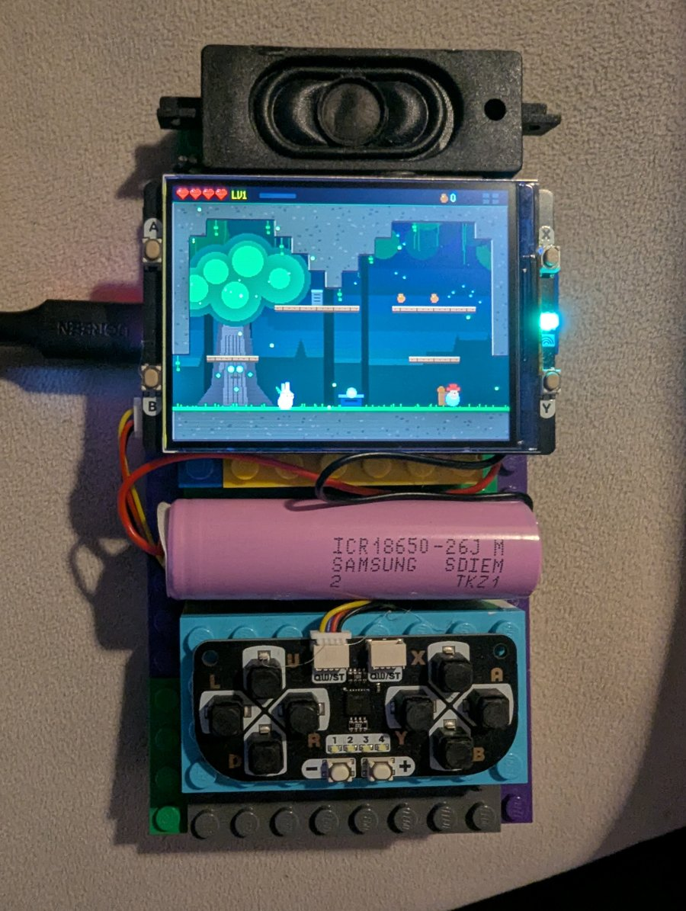
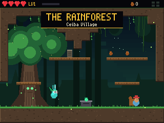
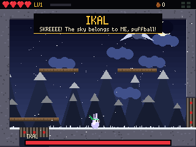
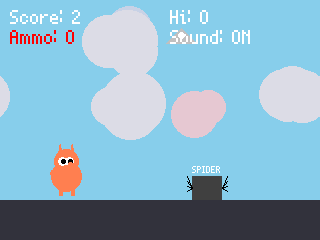
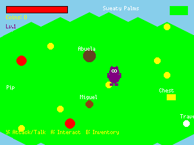
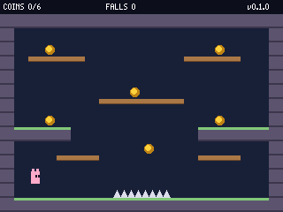
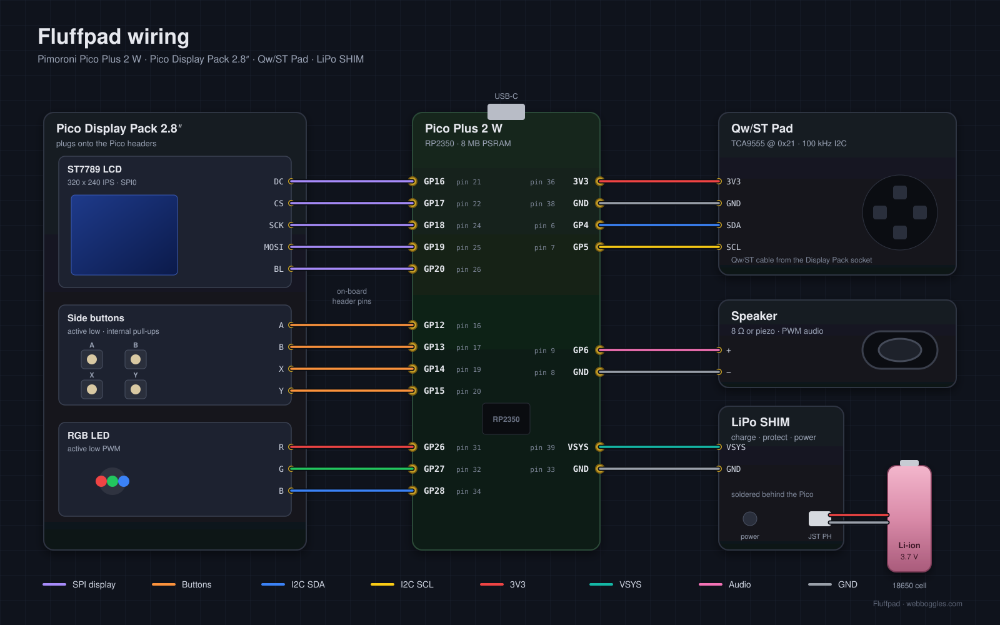

# Fluffpad

A pocket games console built from a Raspberry Pi RP2350 and Pimoroni parts, with three MicroPython games starring La-Fluff-Puff and friends, plus a one-room platformer starter for making your own.



[](https://youtu.be/6VVI-QsO-Uw)

## Games

| Game | Version | Genre | Folder |
| --- | --- | --- | --- |
| La-Fluff-Puff and the Jade Sun | 1.0.0 | Flip-screen metroidvania RPG | [`software/games/jade_sun`](software/games/jade_sun) |
| La-Fluff-Puff Skedaddle | 1.0.0 | Endless runner | [`software/games/skedaddle`](software/games/skedaddle) |
| Fluffbert's Frozen Dream | 0.5.0 | Isometric adventure (work in progress) | [`software/games/frozen_dream`](software/games/frozen_dream) |
| Platformer Bootstrap | 0.1.0 | One-room platformer starter | [`software/games/platformer_bootstrap`](software/games/platformer_bootstrap) |

Each game's version is `__version__` in its package `__init__.py` (Jade Sun, Platformer Bootstrap) or at the top of its `main.py` (Skedaddle, Frozen Dream).

### La-Fluff-Puff and the Jade Sun

 

Restore the Jade Sun across 19 rooms, five zones and five bosses inspired by Maya myth. Design notes and world map: [documentation/jade_sun_design.md](documentation/jade_sun_design.md).

| Input | Action |
| --- | --- |
| D-pad | Move, Up to talk, read or save, Down + jump drops through planks, Down + attack in the air to pogo |
| B | Jump (double jump with the Quetzal Feather, swim with the Rain Pearl) |
| Y | Obsidian Blade |
| A | Jaguar Dash |
| X | Sun Spear (hold to charge) |
| + / display A | Map and stats |
| - / display B | Pause |
| display X | Volume |

### La-Fluff-Puff Skedaddle



Roll a random La-Fluff-Puff, then jump bizarre obstacles and shoot UFOs on an alien planet. Design brief: [documentation/skedaddle_design.md](documentation/skedaddle_design.md).

| Input | Action |
| --- | --- |
| Pad Y | Start, jump (hold for higher) |
| Pad A / display A | Fire weapon |
| display B | Pause |
| display X | Restart after game over |
| display Y | Sound on / off |

### Fluffbert's Frozen Dream



Fluffbert explores Maya-inspired lands on a quest to invent ice cream. Design brief: [documentation/frozen_dream_design.md](documentation/frozen_dream_design.md).

| Input | Action |
| --- | --- |
| display X / Y | Menu up / down |
| display A / pad A | Menu select |
| D-pad | Move |
| Pad Y | Attack or talk |
| Pad A | Interact |
| Pad X / A / Y / B | Dialogue answers 1 to 4 |
| display A / B / X / Y | Pause / inventory / character / map |
| display B | Back to the game from any screen |

### Platformer Bootstrap



A plain, single-room version of the Jade Sun engine to start new games from: the same turbo clocks, cached background blit, Qw/ST Pad input and tile physics (coyote time, jump buffering, variable jump height, one-way planks), without the story, enemies or abilities. Collect every coin and avoid the spikes.

| File | Purpose |
| --- | --- |
| `platformer/hw.py` | Clocks, display buffers, pad and button input, RGB LED |
| `platformer/room.py` | The room map (edit the `MAP` strings), collision and tile art |
| `platformer/player.py` | Movement and collision |
| `platformer/sound.py` | PWM sound effects |
| `platformer/game.py` | Main loop, coins, HUD |

| Input | Action |
| --- | --- |
| D-pad left / right | Move |
| Pad B or A | Jump (hold for higher), Down + jump drops through planks |
| display X | Sound on / off |
| display Y | Restart |

## Hardware



Pimoroni Pico Plus 2 W, [Pico Display Pack 2.8"](https://shop.pimoroni.com/products/pico-display-pack-2-8?variant=42047194005587), [Qw/ST Pad](https://shop.pimoroni.com/products/qwst-pad?variant=53514400596347) and a small speaker on GP6. Parts list, pinout and pad register map: [hardware/README.md](hardware/README.md).

## Install

1. Flash the [Pimoroni MicroPython firmware](https://github.com/pimoroni/pimoroni-pico-rp2350/releases) for the Pico Plus 2 W.
2. Set up the desktop tools (Python 3.9+):

   ```bash
   cd software
   python3 -m venv .venv
   .venv/bin/pip install -r requirements.txt
   ```

3. Plug in the Pico and push a game. Packages are precompiled to `.mpy`, and the game's `main.py` goes to the board root so it starts on power-up:

   ```bash
   ./deploy.sh jade_sun
   ```

   Set `PORT=/dev/cu.usbmodemXXXX` if more than one board is connected. Single-file games can also be copied by hand: `mpremote cp games/skedaddle/main.py :main.py`.

## Desktop emulator

`software/emulator/run_emu.py` runs any game headless on CPython against mocks of `machine`, `picographics`, `pimoroni` and `pimoroni_i2c`. It saves PNG frames, GIFs and a WAV of the PWM audio, and takes scripted button input.

```bash
cd software
.venv/bin/python emulator/run_emu.py --game skedaddle --frames 300 --shots 100,300 --press '20:Y:2'
.venv/bin/python emulator/run_emu.py --game jade_sun --frames 600 --every 60 --gif 1:300:3
```

Button names for `--press` and `--input` are `U D L R A B X Y + -` for the pad and `DA DB DX DY` for the display buttons. Run with `--help` for all options.

Jade Sun ships extra checks in `software/games/jade_sun/tools/`:

```bash
.venv/bin/python games/jade_sun/tools/check_world.py      # map consistency
.venv/bin/python games/jade_sun/tools/solve_world.py      # physics reachability per ability stage
.venv/bin/python games/jade_sun/tools/fuzz.py             # soak test every room
.venv/bin/python emulator/run_emu.py --module tools.boss_test --frames 30000 --seed 1
.venv/bin/python games/jade_sun/tools/playthrough.py      # bot plays to the ending, writes an MP4
```

## Repository layout

```
hardware/          parts, pinout, photos
software/
  deploy.sh        build and push a game to the Pico
  emulator/        headless desktop emulator and hardware mocks
  games/<game>/    one folder per game, main.py is the entry point
documentation/     design notes and screenshots
```

## Licence

Copyright &copy; 2025-2026 [Ilya Titov](https://webboggles.com). Released under the [PolyForm Noncommercial 1.0.0](LICENSE.md) licence: free for personal, educational and other non-commercial use. Keep the `Required Notice` line from [LICENSE.md](LICENSE.md) with any copy or derivative. For commercial use, get in touch via [webboggles.com](https://webboggles.com).
