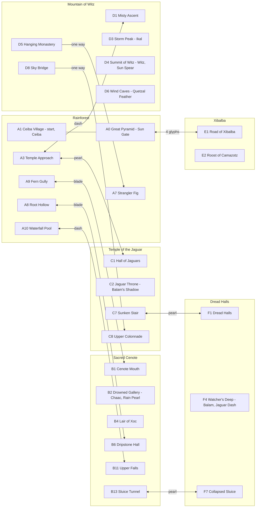
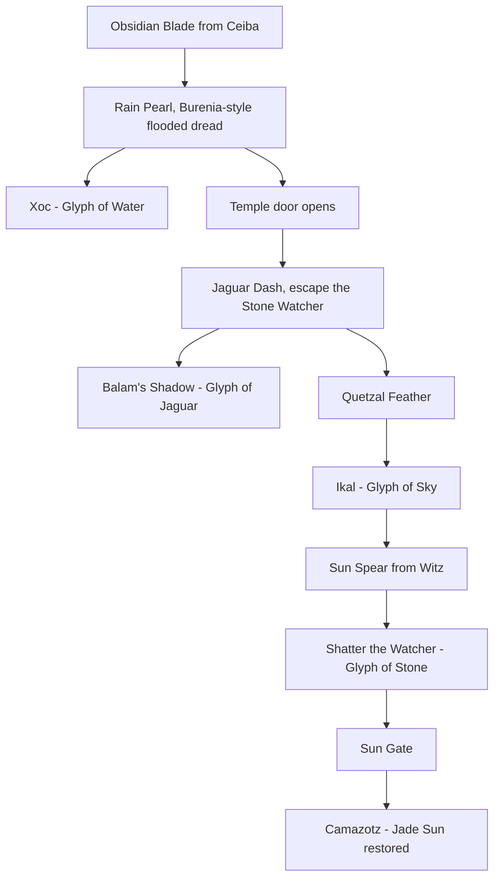

# La-Fluff-Puff and the Jade Sun

Flip-screen metroidvania RPG for Pico Plus 2 W + Pico Display Pack 2.8" + Qw/ST Pad.

## Hardware notes

- `clk_peri` is remapped to `clk_sys / 2` at 250 MHz so the ST7789 SPI runs at 62.5 MHz: `update()` drops from 61 ms to 23 ms.
- Static room art is baked once into a background buffer and memcpy'd into the framebuffer each frame (3.7 ms).
- Fixed 25 fps step. Pad LEDs 1 to 4 show collected Sun Glyphs. RGB LED breathes the zone mood.

## Controls

| Input | Action |
| --- | --- |
| D-pad | Move, `U` talk / read / save, `D` + jump drops through planks, `D` + attack in air = pogo |
| B | Jump (double jump with Quetzal Feather, swim with Rain Pearl) |
| Y | Obsidian Blade |
| A | Jaguar Dash |
| X | Sun Spear (hold to charge) |
| + / display A | Map and stats |
| - / display B | Pause |
| display X | Volume |

## World

54 rooms in six zones, one file each (`jade_sun/world_<zone>.py`), composed by `world_data.py`. Room counts: Rainforest 11, Sacred Cenote 13, Temple of the Jaguar 7, Dread Halls 7, Mountain of Witz 9, Xibalba 7. Zone links below are taken from the solver's room graph (`tools/out/room_graph.json`); labels give the first ability stage at which the crossing works.

## Progression

## Files

All paths are under `software/games/jade_sun/`.

- `jade_sun/` game package, `main.py` entry point.
- `tools/check_world.py` map validator (sizes, seams, markers, stages, corner pinches), `tools/solve_world.py` physics reachability solver; a whole-world run also writes `tools/out/room_graph.json`, which `tools/playthrough.py` routes over.
- `tools/zone_map.py` renders a zone sheet, `tools/art_budget.py` counts draw calls per sprite and room bake against the device caps.
- `tools/fuzz.py`, `tools/boss_test.py`, `tools/scenario.py`, `tools/room_tour.py` emulator soak and story tests; `tools/playthrough.py` bot playthrough to MP4.
- `tools/device_perf.py`, `tools/device_profile.py` on-device timing.
