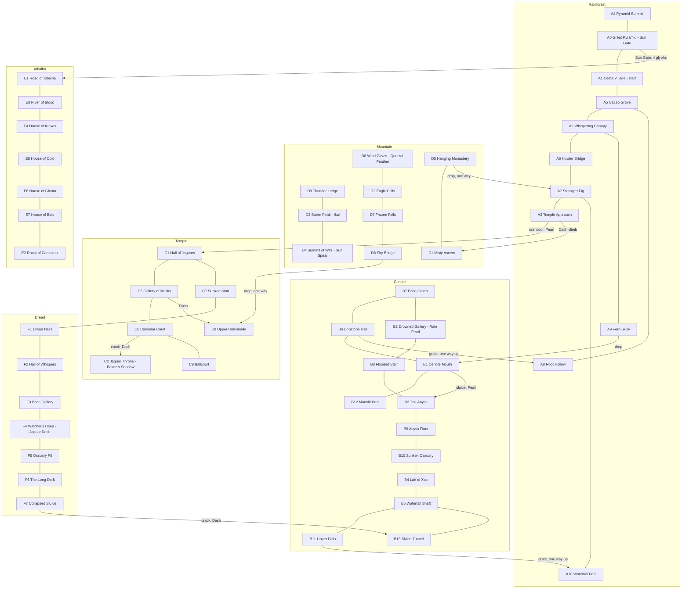
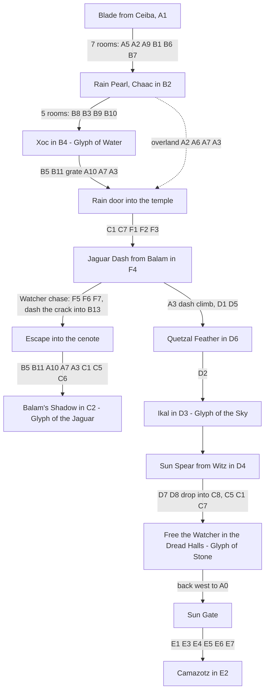

# Jade Sun redesign plan: low-poly art and a Dread-style world

Two parallel swarms work from this plan, then a polish pass integrates them.

- **Art swarm** (8 agents): rebuild every asset as articulated low-poly art.
- **Map swarm** (6 agents): replace the 19-room box map with 54 organic rooms in six zones.

All paths below are relative to `software/games/jade_sun/`. Run every command from `software/`.

## Ground rules for every agent

1. **Edit only the files you own** (tables below). Other agents are editing the rest at the same time. If you need a change elsewhere, say so in your final report instead of making it.
2. Do not commit, push, or run `deploy.sh`. Do not touch `tools/` except to read and run it.
3. MicroPython 1.2x on an RP2350: no f-strings with `=`, no walrus, no `dataclasses`, no type hints, no `match`. Keep allocation low in anything drawn every frame.
4. British English in all player-facing text. No em dashes.
5. Match the surrounding code style: short functions, terse names, sparse comments (only for constraints the code cannot show).
6. Finish with your checks green, then report: files changed, check output summary, anything you could not do.

## Tools

| Command | Purpose |
| --- | --- |
| `.venv/bin/python games/jade_sun/tools/art_budget.py --only <group>` | Draw-call count per sprite against the cap, plus contact sheet `tools/out/art/<group>.png` (open it with the Read tool to look at your art). Groups: `fluff, enemies, bosses, npcs, portraits, items, projectiles, rooms`. `--zoom 4` for bigger sheets. |
| `.venv/bin/python games/jade_sun/tools/zone_map.py --zone <zone> --items` | Bakes every room of a zone at its grid position into `tools/out/maps/<zone>.png`. |
| `.venv/bin/python games/jade_sun/tools/check_world.py --zone <zone>` | Static checks: sizes, markers vs meta, stages, edge alignment with neighbours. |
| `.venv/bin/python games/jade_sun/tools/solve_world.py --zone <zone>` | Physics reachability per ability stage from the zone's `ENTRY` list, using the real `Player`. Proves stages, finds, and no soft-locks. Leaving the zone counts as a safe exit. |
| `.venv/bin/python emulator/run_emu.py --game jade_sun --frames 600 --every 60` | Headless run of the whole game; PNG frames in `emulator/out`. |
| `.venv/bin/python -m pyflakes games/jade_sun/jade_sun/<file>.py` | Lint. |

The original art and map are in git: `git show HEAD:software/games/jade_sun/jade_sun/sprites.py`, `... gfx.py`, `... bosses.py`, `... world_data.py`.

## Device budget

Measured on the Pico before the redesign: room entry 200 to 260 ms, frame 35 to 40 ms against a 40 ms frame (`display.update()` alone is 23 ms). Moving sprites therefore have about 3 ms of headroom in total; baked room art is paid once per room entry.

| Group | Cap (draw calls per sample, max over frames and states) | Original |
| --- | --- | --- |
| Fluff (player) | 42, charge 52, trail 40 | 17 |
| Each enemy, lurker | 28 | 5 to 10 |
| Each boss | 72 | 11 to 26 |
| NPC in world | 40 (Witz 48) | 7 to 14 |
| Portrait (dialogue only) | 52 | 7 to 20 |
| Item | 26 (glyph 30, big variants x1.5), heart pickup 8, cacao 10 | 1 to 15 |
| Projectile | 8 (wave 5, bubble 6, orb 6, bat 10) | 1 to 6 |
| Room bake | 2000 calls per room | 565 to 1397 |

`art_budget.py` enforces these and exits 1 when over.

## Art direction

**Low poly, articulated, more detail. Triangles and layers, not boxes.**

- **Triangles first**: every mass (head, torso, limb, wing, ear, tail, rock, tree) is several overlapping triangles, not one rectangle or circle. Use `rig.tri` and `rig.poly`. A rectangle is only a thin strip. A circle is only an eye, pearl, orb, sun or bubble.
- **Layering, back to front**: dark underside or far limb, then mid facets, then a lit top facet, then a small accent (tooth, feather tip, glyph, glint). At least three layers on every major mass so it reads as a cut gem. Draw far parts first.
- **Jagged silhouette**: the outline is a cluster of points. If a shape still reads as a box or a disc, add another pass of facets.
- **Light from above**, every asset: a lit top facet, a mid body, a dark underside. This is mirror-safe, so facing left or right never flips the lighting.
- **Articulated**: limbs, wings, tails and jaws are jointed chains (`rig.limb` returns the end joint so the next bone hangs off it). Animate the joint angles from `t` and state, not by swapping whole shapes. Two to three bones per limb at most.
- **Detail** goes into silhouette and a few well-placed accents (eye glints, feather tips, glyph inlays, teeth), not into noise.
- Keep each character's identity, palette and readable hitbox footprint. Anything that hurts must still read as dangerous: telegraph states (`tell`, `crouch`, `dashtell`, `storm` warning, Watcher `alert`) need a visible pose change.
- Colour: reuse the existing pens and `gfx.pen(r, g, b)` (pens are cached; never call `display.create_pen` directly). `gfx.shade(c, k)` makes facet tones from a base colour.

### `jade_sun/rig.py` (shared, read-only for everyone)

| Helper | Use |
| --- | --- |
| `poly(pts, ox, oy, f)` | Template polygon, mirrored when `f < 0`. Keep `pts` as module-level tuples. |
| `tri(ox, oy, f, x0, y0, x1, y1, x2, y2)` | Mirrored triangle. Zero allocation; prefer it in per-frame sprites. |
| `limb(x, y, ang, ln, w0, w1)` | Tapered bone quad; returns the end joint for chaining. |
| `joint(x, y, ang, ln)` | End point only, for placing things on a rig. |
| `ngon(cx, cy, r, n, rot)` / `ngon_pts` | Faceted disc (cached offsets). |
| `crescent(cx, cy, r, depth, shadow, body)` | Round form with an underside crescent shadow, 2 calls. |
| `gem(cx, cy, r, lit, mid, dark, n)` | Faceted ball with lit and dark facets, 3 calls. |
| `sin64(a)`, `cos64(a)` | Table sine for 64-step animation cycles. |

Per-frame sprites: `rig.tri` is free (no allocation) and is the default. `polygon` via `poly`, `limb` and `ngon` is fine for the larger masses. Cache templates as module-level tuples.

### Art ownership

| Agent | Owns | Must keep |
| --- | --- | --- |
| art_fluff | `jade_sun/sprites_fluff.py` | `FLUFF_COLOURS`, `FLUFF_NAMES`, `FluffSkin` (body, dark, light pens), signatures of `draw_fluff`, `draw_slash`, `draw_trail`, `draw_charge`. `draw_fluff` is also used at scale 2 (portrait) and 3 (form screen), so it must scale cleanly with `scale`. Hitbox is 10x14 at (x, y). Headband quetzal feather, long ears and big eyes are the character. |
| art_enemies | `jade_sun/sprites_enemies.py` | `draw_enemy(e, t)` for frog, snake, bat, eel, warrior, mask, swift, wisp and `draw_lurker(e, t)`. Read `enemies.py` for sizes (`STATS`) and states (warrior windup `state 1` and strike `state 2`, mask glow `timer > 50`, frog `vy < 0` leap). `e.flash > 0` draws white. |
| art_bosses | `jade_sun/boss_art.py` | `draw_xoc`, `draw_jaguar`, `draw_eagle`, `draw_watcher`, `draw_camazotz`, each `(b, t)`. Read `bosses.py` for states and hitboxes; the art must cover the hit rects. `b.body_pen(c)` gives the flash pen. Xoc uses `b.trail` (48 positions) for its body. The Eagle storm bolts and the Watcher sight line are gameplay telegraphs; keep them obvious. |
| art_npcs | `jade_sun/sprites_npcs.py` | `draw_npc(kind, x, y, t, talking)` for ceiba, ek, chaac, balam, witz and `draw_portrait(kind, x, y, t, skin)` (36x36 panel) for those plus `fluff`, `stone` and the default (Camazotz). Ceiba is a spirit living in the great tree baked into the Ceiba Village backdrop: the NPC is her face and glow on the trunk at the marker, so keep it compatible with any tree. Witz is a huge stone face 52x56 above its marker. |
| art_items | `jade_sun/sprites_items.py` | `draw_proj`, `draw_heart`, `draw_cacao`, `ITEM_COL`, `draw_item(kind, x, y, t, big)` for blade, pearl, dash, feather, spear, heart, glyph and the **new `shard`** (a jade shard; four make a heart). `draw_heart` is also the HUD heart (r=3), so it must stay crisp at small sizes and cheap. |
| art_tiles | `jade_sun/tiles.py` | `draw_room(room, pal, glyphs)` and the live effects `draw_surfaces`, `draw_flame`, `draw_shrine_glow`, `draw_lore_glint`. Collision is unchanged and square, so art must match it: solid tiles look solid where you can stand. See "Tiles" below. |
| art_backdrops | `jade_sun/backdrops.py` | `BACKDROPS[zone](rid, z)` for jungle, cenote, temple, dread, mountain, xibalba, drawn under the tiles. Keep the Ceiba tree in `A1` (`_ceiba_tree`, the spirit lives in it, around x 40 to 100). Deterministic: only `random` (already seeded per room by `gfx.bake`). |
| art_ui | `jade_sun/ui.py`, `jade_sun/intro.py` | Restyle panels, banners, the item-get burst, title and prologue art in the same low-poly language. **Rewrite `map_screen`** in the Metroid Dread style (see below). Keep every function signature that `game.py` calls. |

### Tiles

The world must stop looking like a grid of boxes, without changing collision.

- **Bevel convex corners**: where a solid tile has open air on two adjacent sides, cut the corner with a facet (a triangle in the backdrop colour is not possible because the backdrop is already drawn, so draw the rock as a polygon with the corner clipped instead of a full square). Keep cuts 3 to 6 px so collision still feels honest.
- **Fill inside corners** (open tile with solid on two adjacent sides) with a small rock fillet triangle so the outline reads as one organic mass.
- **Faceted surfaces**: top faces get a lit facet strip with an irregular polygon edge (grass, moss, snow, gilded stone, bone, depending on zone), side faces mid tone, undersides dark with drips, roots and stalactites as triangles.
- **Interior tiles are cheap**: tiles surrounded by rock should cost 1 to 3 calls; spend the budget on edges. Consider merging horizontal runs of interior rock into one rectangle.
- Zone material language: jungle earth and roots, cenote limestone and wet highlights, temple dressed stone and carved glyphs, dread dark stone and red veins, mountain granite and snow caps, xibalba obsidian and ember cracks.
- Planks, grates, spikes, water, sun seal, rain door, sun gate (lights per glyph), boss shutters, shrine, stele and torch: each gets a low-poly pass. Water stays readable as water and its depth gradient stays.

### Dread-style map screen (`ui.map_screen`)

- The world grid is now up to 13 x 9 cells. Size cells to fit the screen above the stats line (about 22 x 15 px per cell at `ox, oy = 17, 26`).
- Visited rooms are filled with their zone colour. Draw a wall line on every edge of a visited room **except** where it opens into its neighbour, so connected rooms read as one irregular space, as in Dread. A room counts as open into a neighbour when any passable tile pair lines up on the shared edge (rock is `#`; everything else counts as passable, matching `tools/check_world.py`).
- Openings between different zones get a small door mark in the colour of the zone you have not visited, or white once both are visited.
- Markers: shrine (jade), boss (red, grey once beaten), unfound items or lore in a visited room (gold), current room blinking.
- Unvisited rooms next to a visited room show as a faint outline only.
- Precompute the edge openness once (module level, from `world_data.ROOMS`) rather than every frame.

## World

54 rooms on a 13 x 9 grid. Zones: Rainforest (`A`), Sacred Cenote (`B`), Temple of the Jaguar (`C`), Dread Halls (`F`), Mountain of Witz (`D`), Xibalba (`E`). Coordinates are `(x, y)` with y growing downwards.

### Progression and travel

Stage order: `blade < pearl < dash < feather < spear < gate`. Each room's `"stage"` is the first stage at which it must be reachable, and it must **not** be reachable earlier. `FINDS` does the same for items, spirits and lore. The solver proves both.

### Room table

| Room | Pos | Name | Stage | Contents (fixed) |
| --- | --- | --- | --- | --- |
| A0 | 1,3 | Great Pyramid | blade | lore l7; Sun Gate `G` blocks the way down to E1 |
| A4 | 1,2 | Pyramid Summit | feather | shard2 (feather) |
| A1 | 2,3 | Ceiba Village | blade | start; Ceiba `N`; trader `D`; lore l1; shrine |
| A5 | 3,3 | Cacao Grove | blade | |
| A8 | 3,4 | Root Hollow | blade | shard1 (blade) |
| A2 | 4,3 | Whispering Canopy | blade | rain; heart1 (dash) |
| A9 | 4,4 | Fern Gully | blade | drop into the cenote |
| A6 | 5,3 | Howler Bridge | blade | rain; shard3 (spear, behind a sun seal `S`) |
| A7 | 6,3 | Strangler Fig | blade | shrine |
| A10 | 6,4 | Waterfall Pool | blade | grate from B11 |
| A3 | 7,3 | Temple Approach | blade | rain; lore l2; rain door to C1; dash climb to D1 |
| B1 | 4,5 | Cenote Mouth | blade | sluice: rain door floor `R` down towards B3 |
| B12 | 5,5 | Moonlit Pool | dash | shard4 (dash) |
| B6 | 3,5 | Dripstone Hall | blade | grate up to A8 |
| B7 | 2,5 | Echo Grotto | blade | shard6 (spear, behind a sun seal) |
| B2 | 2,6 | Drowned Gallery | blade | lurker; Chaac `N`; lore l3; shrine |
| B8 | 3,6 | Flooded Stair | pearl | deep water link B2 to B3 |
| B3 | 4,6 | The Abyss | pearl | heart2 (pearl) |
| B9 | 4,7 | Abyss Floor | pearl | shard5 (pearl) |
| B10 | 5,7 | Sunken Ossuary | pearl | lore l8 |
| B4 | 6,7 | Lair of Xoc | pearl | boss xoc (arena kept) |
| B5 | 6,6 | Waterfall Shaft | pearl | |
| B11 | 6,5 | Upper Falls | pearl | shrine; grate up to A10 |
| B13 | 7,6 | Sluice Tunnel | pearl | Watcher escape exit |
| C1 | 8,3 | Hall of Jaguars | pearl | shrine; torches |
| C7 | 8,4 | Sunken Stair | pearl | way down to F1 |
| C5 | 9,3 | Gallery of Masks | pearl | |
| C8 | 9,2 | Upper Colonnade | dash | heart3 (spear, behind a sun seal); drop-in from D8 |
| C6 | 10,3 | Calendar Court | pearl | lore l9; cracked wall to C2 |
| C9 | 10,4 | Ballcourt | pearl | shard7 (dash) |
| C2 | 11,3 | Jaguar Throne | dash | boss jaguar (arena kept) |
| F1 | 8,5 | Dread Halls | pearl | watcher; `Z` |
| F2 | 9,5 | Hall of Whispers | pearl | watcher |
| F3 | 10,5 | Bone Gallery | pearl | watcher; lore l4 |
| F4 | 11,5 | Watcher's Deep | pearl | watcher; Balam `N`; `Z` (required) |
| F5 | 10,6 | Ossuary Pit | pearl | watcher; shard8 (dash) |
| F6 | 9,6 | The Long Dark | pearl | watcher; lore l10 |
| F7 | 8,6 | Collapsed Sluice | pearl | watcher; cracked wall to B13 |
| D1 | 7,2 | Misty Ascent | dash | lore l5; shrine |
| D5 | 6,2 | Hanging Monastery | dash | shard9 (dash); drop to A7 |
| D6 | 6,1 | Wind Caves | dash | Quetzal Feather (dash) |
| D2 | 7,1 | Eagle Cliffs | feather | heart4 (feather) |
| D9 | 6,0 | Thunder Ledge | feather | shard10 (feather) |
| D3 | 7,0 | Storm Peak | feather | boss eagle (arena kept) |
| D4 | 8,0 | Summit of Witz | feather | Witz `N`; shrine |
| D7 | 8,1 | Frozen Falls | feather | lore l11 |
| D8 | 9,1 | Sky Bridge | feather | drop into C8 |
| E1 | 1,4 | Road of Xibalba | gate | lore l6; shrine |
| E3 | 1,5 | River of Blood | gate | |
| E4 | 0,5 | House of Knives | gate | shard11 |
| E5 | 0,6 | House of Cold | gate | |
| E6 | 1,6 | House of Gloom | gate | lore l12 |
| E7 | 1,7 | House of Bats | gate | shard12; shrine |
| E2 | 1,8 | Roost of Camazotz | gate | boss camazotz (arena kept) |

Map agents may add cacao `c`, enemies, torches `T`, spikes, planks and extra cracked-wall secrets freely, and may move markers within their rooms. They must not add or remove items, spirits, lore, shrines, bosses or rooms.

### Portal contract (fixed tiles at zone borders)

Columns and rows are 0-based. "Open" means not `#`. Both sides are already cut this way in the placeholder maps; keep them exactly.

| Link | Tiles | Notes |
| --- | --- | --- |
| A3 east / C1 west | rows 9 to 11: A3 col 19 `R`, C1 col 0 `.`; row 12 solid on both | rain door, opens with the Pearl |
| A3 north / D1 south | cols 15 to 17 open on A3 row 0 and D1 row 13 | A3 must make reaching its row 0 there **require dash** |
| A9 south / B1 north | cols 8 to 10 open | drop into the cenote |
| A8 south / B6 north | A8 row 12 cols 4 to 6 `g`, row 13 cols 4 to 6 `.`; B6 row 0 cols 4 to 6 `.` | one-way up; B6 needs a ledge 2 to 3 tiles below its top so you can jump through |
| A10 south / B11 north | A10 row 12 cols 8 to 10 `g`, row 13 `.`; B11 row 0 cols 8 to 10 `.` | one-way up, same rules |
| A0 south / E1 north | cols 9 to 10 open | the Sun Gate `G` inside A0 blocks this until the gate opens |
| A7 north / D5 south | cols 2 to 3 open | one-way drop from the mountain; A7 must keep that hole out of reach (at least 5 tiles of open air above any foothold) |
| C7 south / F1 north | cols 14 to 15 open | two-way at pearl: F1 needs footholds to jump back up |
| C8 north / D8 south | cols 16 to 17 open | one-way drop; C8 must keep the hole out of reach without the Feather |
| B13 east / F7 west | rows 10 to 11: B13 col 19 `.`, F7 col 0 `.`, F7 col 1 `%`; row 12 solid on both | the crack sits one tile inside F7 so nobody spawns inside rock |
| C6 east / C2 west | rows 9 to 11: C6 col 18 `%`, col 19 `.`; C2 col 0 `B` | boss doors |
| D2 north / D3 south | cols 2 to 4 open | D3 row 13 is `B` |
| D3 east / D4 west | rows 9 to 11 open | D3 col 19 is `B` |
| B5 south / B4 north | cols 8 to 10: B5 row 13 `~`, B4 row 0 `B` | |
| B10 east / B4 west | rows 9 to 11: B10 col 19 `~`, B4 col 0 `B` | |
| E7 south / E2 north | cols 10 to 12 open | E2 row 0 is `B` |
| E3 / B7, E6 / B2, C9 / F3 | sealed: solid on both sides of the shared edge | different zones, no link |

Every other edge between two rooms of **your own zone** is yours to design; both rooms are yours, so keep them aligned. Edges with no neighbour are solid in play even if drawn open; keep them rock unless it is open sky (mountain tops, summit).

### Physics, measured with the real Player

| Move | Reach |
| --- | --- |
| Single jump (held) | 58 px high (3.6 tiles): a ledge 3 tiles up is reachable, 4 is not |
| Running jump | 78 px across (4.9 tiles) on the flat |
| Double jump (Feather) | 105 px high (6.5 tiles) |
| Jump + dash | 145 px across (9 tiles) |
| Double jump + dash | 209 px across, 104 px high |
| Water without Pearl | sinks; only a tiny hop off the bottom. Head above water can jump out (-7.5) |
| Water with Pearl | swim up freely |
| Room transition up | crossing the top edge boosts `vy` to -9, so a jump that reaches row 0 carries into the room above |

Gate recipes that the solver respects:

- **Dash gate**: a gap 6 to 8 tiles wide over a pit or spikes, or a `%` cracked wall (dash breaks it; the charged spear beam breaks it too).
- **Feather gate**: a ledge 5 to 6 tiles above the highest foothold, with nothing to climb in between.
- **Pearl gate**: a passage only through water at least 3 tiles deep, or a rain door `R`.
- **Spear gate**: a sun seal `S` (only the charged beam breaks it).
- **Never** let deep water be reachable at a stage without the Pearl unless you can walk out of it: that is a soft-lock.
- Spikes `^` hurt and respawn you; the solver treats them as walls.

### Level design rules (Metroid Dread feel)

1. **No boxes.** Rooms are carved spaces: irregular walls 1 to 4 tiles thick, slopes built as 1-tile stair steps, overhangs, pillars, stalactites, uneven floors and ceilings. The outer border is part of the shape, not a frame.
2. **Room types**: mix tall shafts, long corridors, wide halls, small connector rooms and hubs. Each zone gets at least one shaft and one long corridor.
3. **Every room has a job**: a traversal challenge, a combat set piece, a secret, a shortcut, a landmark or a reward.
4. **Tease, then pay off**: show items and gated paths before they are reachable (an item visible behind a crack or across a dash gap).
5. **Loops and shortcuts**: after a boss or a key item, open a fast way back (one-way grate, drop, crack you can now break).
6. **Breadcrumbs**: cacao trails hint at routes and secrets.
7. **Readable footholds**: platforms `=` sparingly; prefer rock ledges. Leave 2 tiles of headroom for corridors and 3 for comfort.
8. **Combat**: one to four enemies per room, placed where they matter. The Dread Halls are the Watcher's domain: few enemies, long sightlines with hiding pockets (low ceilings, alcoves) to break line of sight.
9. **Boss arenas keep their geometry**: B4, C2, D3, E2 keep their floor rows, door tiles and `K` position. You may reshape their outer walls and ceilings to be less boxy.

### Zone file format

Each zone file (`jade_sun/world_<zone>.py`) has `ENTRY`, `LORE`, `FINDS`, `ROOMS`. Keep the keys. `ENTRY` lists `(room, x, y, first stage)` where the solver starts a zone: a spot just inside the zone's entrance (x, y is the player's top-left; standing on a floor at row r means y = r * 16 - 14). Placeholder lore says `TODO lore:`; replace it with one or two sentences of Maya-inspired lore in the game's warm, funny voice (look at the existing entries).

### Map ownership and briefs

| Agent | Owns |
| --- | --- |
| map_jungle | `jade_sun/world_jungle.py` |
| map_cenote | `jade_sun/world_cenote.py` |
| map_temple | `jade_sun/world_temple.py` |
| map_dread | `jade_sun/world_dread.py` |
| map_mountain | `jade_sun/world_mountain.py` |
| map_xibalba | `jade_sun/world_xibalba.py` |

**Rainforest.** Hub zone, surface band at y=3 with an understory at y=4. Wide, green, layered: canopy platforms high, roots and hollows low. A1 keeps the start on solid floor (update `ENTRY` if the start spot moves; it is also the new-game start). A1 west to A0 pyramid, east through A5 to A2. A5 has a way down into A8. A2 has a way down into A9 and on east to A6, A7, A3. A2's heart1 sits behind a cracked wall (dash). A6 is a long rope-bridge corridor over a chasm with shard3 behind a sun seal. A7 is a vertical room around a giant strangler fig with a drop down to A10; its ceiling hole to D5 must stay out of reach. A4 sits on top of the pyramid and needs the Feather. A0 holds the Sun Gate floor; inside, below the gate, planks lead down to the E1 opening. A3: rain door east; the climb to D1 needs dash (a dash gap to the climbing ledges).

**Sacred Cenote.** Wet, vertical, blue. At blade stage B1, B6, B7 and B2 form a dry-ish cave loop with shallow water only; the grate in B6 is the way home to A8. Deep water starts at pearl stage. B1's floor sluice `R` opens with the Pearl as a shortcut down to B3. B8 is a flooded staircase from B2 east to B3. B3, B9 and B10 descend to Xoc's lair B4 (enter from B10 through the west doors). After Xoc, climb out up B5 and B11 (Upper Falls, shrine) and the grate to A10. B13 is a dry tunnel east of B5 that ends at the cracked wall into F7. B12 is a secret grotto reached by dashing through a crack from B1 or B11. The lurker spawns at tile (7, 9) in B2, which must be water, and swims between x 70 and 230.

**Temple of the Jaguar.** Dressed stone, torches, carved glyphs, fire masks and clay warriors. C1 is entered from A3 at rows 9 to 11. C1 to C5 to C6 is the main gallery run; C6's east crack leads into C2. C7 under C1 is a descending stair down into F1. C9 under C6 is a sunken ballcourt with shard7 behind a dash gap or crack. C8 above C5 needs dash to reach and holds heart3 behind a sun seal; its ceiling hole to D8 must not be reachable without the Feather.

**Dread Halls.** The Watcher's EMMI zone, all rooms flagged `watcher`. Long sightlines broken by low ceilings and alcoves to hide in. Entered from C7 into F1. F1 to F2 to F3 to F4, where Balam waits with the Watcher spawn `Z`. After Balam gives the Dash the Watcher hunts: the escape route F4, F5, F6, F7 needs the Dash at least once (a dash gap) and ends with dashing through the crack at F7 col 1 into B13. F5 holds shard8 behind a dash gap or crack. Make sure the player can also walk back up to C7 at pearl stage from F1 (no soft-lock). At least two rooms need a `Z`.

**Mountain of Witz.** Grey granite, snow caps, wind, swifts. Entered from A3 into D1 at cols 15 to 17 at the bottom (update `ENTRY` to a standing spot near there). Dash stage: D1, D5 (monastery, shard9, drop to A7) and D6 (Wind Caves, Feather). D1's way up into D2 must need the Feather. Feather stage: D2 (heart4), D3 (Storm Peak arena, entered from D2 below through the `B` doors), D4 summit with Witz and a shrine (entered from D3's east doors), D7 Frozen Falls under D4, D8 Sky Bridge east of D7 with the drop into C8, D9 Thunder Ledge west of D3 with shard10.

**Xibalba.** The underworld: obsidian, embers, blood rivers. Unlocked only by the Sun Gate (gate stage). A winding descent E1, E3 (River of Blood, water), E4 (House of Knives, spikes and shard11), E5 (House of Cold), E6 (House of Gloom, l12), E7 (House of Bats, shard12, shrine) to Camazotz in E2. This is the final run: make it a gauntlet with wisps and bats, and a shrine in E7 before the boss.

## Polish (after both swarms)

1. Whole-world `check_world.py` and `solve_world.py` green; fix seams between zones.
2. Update the playthrough bot route, `scenario.py`, `boss_test.py`, `fuzz.py`, `device_perf.py` for the new room ids.
3. Budget, visual review of every sheet and the stitched world map, emulator playthrough.
4. On-device timing with `tools/device_perf.py`.
5. Update `documentation/jade_sun_design.md` and the README.
