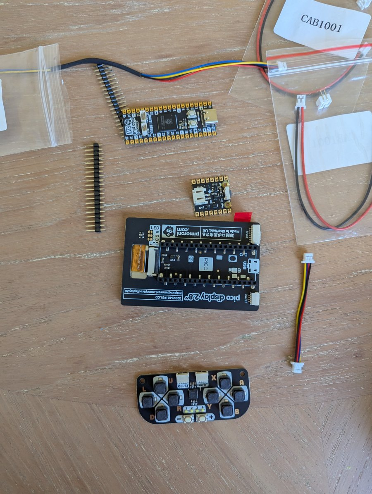
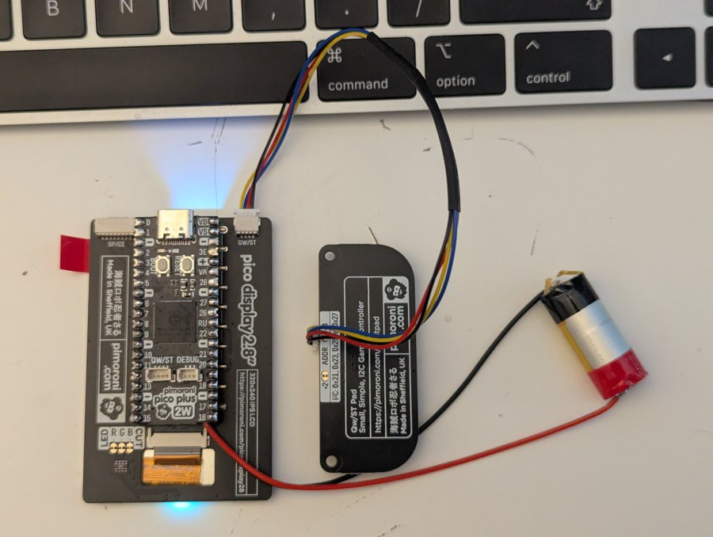
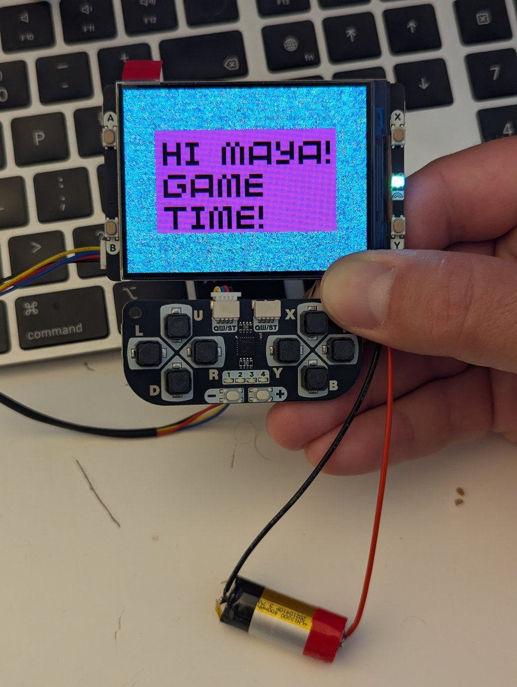

# Fluffpad hardware

A handheld built from off-the-shelf Pimoroni parts on a brick-built frame. No soldering is needed except the speaker leads.

## Parts

| Part | Role |
| --- | --- |
| [Pimoroni Pico Plus 2 W](https://shop.pimoroni.com/products/pimoroni-pico-plus-2-w) (RP2350, 8 MB PSRAM) | MCU |
| [Pimoroni Pico Display Pack 2.8"](https://shop.pimoroni.com/products/pico-display-pack-2-8?variant=42047194005587) (ST7789, 320x240) | Display, 4 side buttons, RGB LED |
| [Pimoroni Qw/ST Pad](https://shop.pimoroni.com/products/qwst-pad?variant=53514400596347) (TCA9555 I2C expander) | D-pad, A/B/X/Y, +/-, 4 LEDs |
| Small 8 ohm speaker or piezo buzzer | Audio (monophonic PWM) |
| Qw/ST (JST-SH 4-pin) cable | Pad connection |
| [Pimoroni LiPo SHIM for Pico](https://shop.pimoroni.com/products/pico-lipo-shim?variant=32369543086163) | Battery power, USB charging, power button |
| Li-ion / LiPo cell | Battery |

The prototype uses a salvaged laptop speaker and a Samsung ICR18650-26J cell; the first build ran from a small cylindrical Li-ion cell.

## Build

1. Solder male headers to the Pico Plus 2 W (pins pointing down) and solder the LiPo SHIM to the back of the Pico, power button at the USB end. The Display Pack's ribbon connector sits underneath, so either use longer headers or solder the Pico and SHIM back to back on the short end of the header.
2. Plug the Pico into the Display Pack, matching the USB end to the board markings.
3. Connect the Qw/ST Pad to the Display Pack's Qw/ST socket with a JST-SH cable.
4. Wire the speaker to GP6 and GND, and connect the battery to the SHIM. The SHIM charges the cell whenever USB is plugged in.

The LiPo SHIM only accepts LiPo or Li-ion cells; keep the cell protected from dents, punctures and crushing.

## Pin connections

The Display Pack plugs straight onto the Pico headers. The only wiring is the Qw/ST cable and the speaker.

| GPIO | Function | Device | Notes |
| --- | --- | --- | --- |
| GP4 | I2C0 SDA | Qw/ST Pad | Qw/ST connector, 100 kHz |
| GP5 | I2C0 SCL | Qw/ST Pad | Qw/ST connector |
| GP6 | PWM audio | Speaker + | Speaker - to GND |
| GP12 | Button A | Display Pack | Active low, internal pull-up |
| GP13 | Button B | Display Pack | Active low, internal pull-up |
| GP14 | Button X | Display Pack | Active low, internal pull-up |
| GP15 | Button Y | Display Pack | Active low, internal pull-up |
| GP16 | LCD DC | Display Pack | Handled by `picographics` |
| GP17 | LCD CS | Display Pack | SPI0 |
| GP18 | LCD SCK | Display Pack | SPI0 |
| GP19 | LCD MOSI | Display Pack | SPI0 |
| GP20 | LCD backlight | Display Pack | PWM |
| GP26 | RGB LED red | Display Pack | Active low PWM |
| GP27 | RGB LED green | Display Pack | Active low PWM |
| GP28 | RGB LED blue | Display Pack | Active low PWM |
| 3V3 / GND | Power | Pad, speaker | Pad powered via Qw/ST cable |

## Qw/ST Pad (TCA9555 @ 0x21)

Inputs are active low. Config register `0x06` is written `0x3F 0xF9`, polarity `0x04` is `0x00 0x00`; inputs read from `0x00`, LEDs written to `0x02` (low = on).

| Expander bit | Function |
| --- | --- |
| 1 | Up |
| 2 | Left |
| 3 | Right |
| 4 | Down |
| 5 | Minus |
| 6, 7, 9, 10 | LEDs 1 to 4 |
| 11 | Plus |
| 12 | B |
| 13 | Y |
| 14 | A |
| 15 | X |

Jade Sun re-initialises the pad about every 2 s if it drops off the bus.

## Firmware

All games run on the [Pimoroni MicroPython build](https://github.com/pimoroni/pimoroni-pico-rp2350/releases) for the Pico Plus 2 W, which provides `picographics`, `pimoroni` and `pimoroni_i2c`.

## Performance notes (Jade Sun)

- `hw.turbo()` sets `clk_sys` to 250 MHz (200 MHz fallback) and remaps `clk_peri` to `clk_sys / 2`. The SDK still assumes 48 MHz, so the ST7789 SPI runs at 62.5 MHz and `display.update()` drops from 61 ms to 23 ms. `hw.restore_clocks()` returns `clk_peri` to USB PLL and `clk_sys` to 150 MHz.
- Two 320x240 RGB565 buffers (`FB`, `BG`, 150 KB each) are allocated at boot; static room art is cached in `BG` and copied into `FB` each frame (3.7 ms).
- Source of truth for pins: `software/games/jade_sun/jade_sun/hw.py` (display, input, RGB LED) and `jade_sun/audio.py` (speaker).
